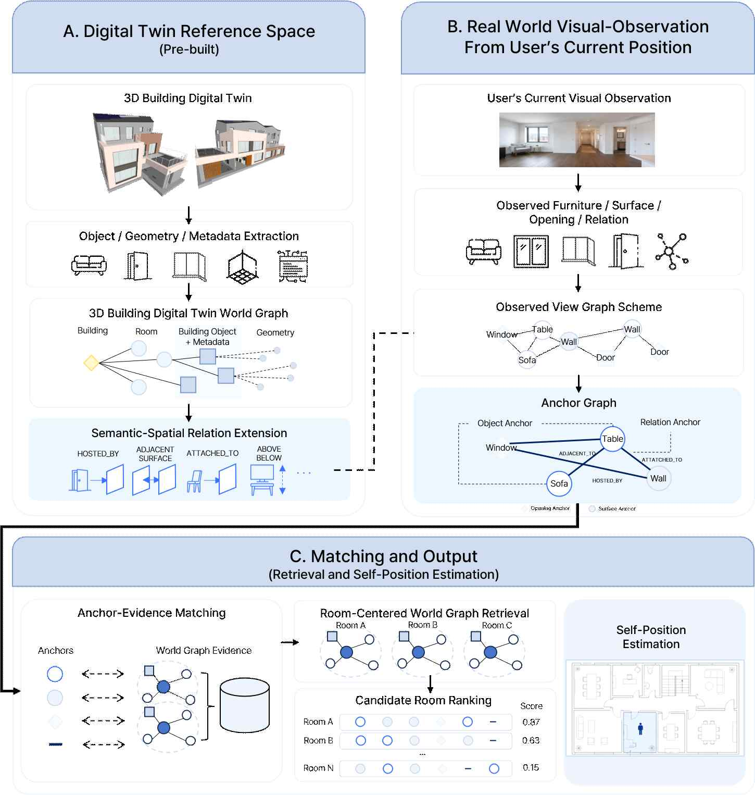

# WorldGraph-Mathematics

Research code for *Room-Level Indoor Position Estimation as Soft Conjunctive Pattern Matching on a 3D Building Digital Twin World Graph*.

Which room could produce this view? The system represents visible furniture, doors, windows and their spatial relationships as an **Observed View Graph**. It matches that graph against rooms in a CityGML 2.0 digital twin and returns a ranked list of candidate spaces. On 336 prepared view-graph queries from the e-Type 201 building, the Full method ranked the target first **245 times (72.92%)** and took **62.3 ms per query** on average with the reference map in memory.



*Figure 1. The paper’s localization framework. The scores in the diagram illustrate an individual prediction. Table 8 reports the measured results.*

## Table 8 · Room retrieval from a single view

Each query comes from one rendered view in a single first-floor capture sequence. All three settings searched the same **10 building-wide candidate spaces**. The 336 target views cover E101 (16), the open-plan living room and kitchen E102+E103 (288), and E104 (32). The living room and kitchen count as one target because they form a continuous physical space.

| Setting | Hit@1 ↑ | Hit@3 ↑ | MRR ↑ | MTR ↓ | Mean warm time per query (ms) ↓ |
| --- | ---: | ---: | ---: | ---: | ---: |
| Full (objects + relations) | **72.92%** | 76.79% | **0.7547** | 3.0446 | 62.305 ± 3.693 |
| Objects only | 72.32% | **78.27%** | 0.7520 | **3.0417** | **15.201 ± 0.748** |
| Relations only | 25.30% | 26.19% | 0.2634 | 8.1905 | 40.891 ± 1.928 |

**What did relations add?** Full uses doors, windows and their host walls to resolve ties in object scores when multiple openings share a wall, or when a single wall-hosted opening provides all the scored evidence. The rule applied to 98 queries. Compared with objects only, correct first-place results rose from 243 to 245, and correct first-place results **without a tie** rose from 169 to 203. Top-three hits fell from 263 to 258. Full gained five first-place hits in E101, lost three in the living room and kitchen, and returned no first-place hits in E104. The rule was developed on this sequence. Independent annotation review and evaluation on a held-out capture are pending.

**How to read the metrics.** Hit@1 and Hit@3 count queries whose target appears in the first one or three positions. MRR is mean reciprocal rank and MTR is mean target rank. A stable space ID orders any remaining ties. All 336 queries contribute to each metric. Abstentions (61 Full, 61 objects only, 238 relations only) receive zero hit and reciprocal-rank credit and a target rank of 11.

**What was timed?** On an AMD Ryzen 7 2700X CPU, the timer ran from normalization of the prepared query graph through anchor selection, matching and final ranking or abstention. Each query and setting received one warm-up and three timed runs. The table gives the mean and sample standard deviation of the three 336-query run means. Image processing, map loading and disk I/O were outside the timer. Retrieval ran entirely in memory.

## Table 6 · Three example queries against Neo4j

The earlier Cypher experiment queried the building graph in Neo4j and ranked E102 and E103 as separate rooms. The original retrieval logs and a separate warm profiling run give two timing measurements for each case.

| Query | Target room | Target rank | Original retrieval (ms) | Warm mean (ms) |
| --- | --- | ---: | ---: | ---: |
| Kitchen | E103 | 1 | 2086.194 | 14.983 |
| Living room with TV and sofa | E102 | 1 | 2086.852 | 15.984 |
| Sparse opening evidence | E204 | 3 | 4033.677 | 55.261 |

Each warm mean covers three measured Cypher calls after warm-up. These queries used the `neo4j` database at `bolt://localhost:7687`. The room query and connection settings are available in the [Cypher generator](src/citygml_sg/retrieval/query_generator/room_localization.py) and [configuration template](configs/default.yaml).

## Run the public example

From the repository root in PowerShell, use Python 3.10 or later. The final command checks the Table 8 ranking rule with synthetic inputs and runs offline.

```powershell
python -m venv .venv
.\.venv\Scripts\python.exe -m pip install -e ".[dev]"
.\.venv\Scripts\python.exe -m pytest -q tests/retrieval/test_opening_pattern_ranker.py tests/retrieval/test_paper_accuracy_cli.py -k "opening_pattern or table8"
```

To evaluate your own observations, supply a query manifest, a frozen graph snapshot and a ledger identifying which rooms support each opening-to-wall relationship. The public runner ranks each query once per setting with the native reference solver. The paper timings above come from the repeated in-memory exact-assignment benchmark. See the [Table 8 runner](scripts/retrieval/run_paper_table8.py), [method configuration](configs/paper_table8_opening.yaml) and [Observed View Graph schema](docs/schemas/observed_view_graph.schema.json).

The repository includes the implementation, synthetic fixtures, Figure 1 and aggregate results. The full capture sequence, annotations, frozen research map and per-query logs are held locally. The CityGML pipeline derives from [3DCitySG](https://github.com/JOyagdol/3DCitySG). See the [graph schema](docs/graph_schema.md), [retrieval guide](docs/retrieval/README.md) and [source provenance](docs/upstream_provenance.json).
